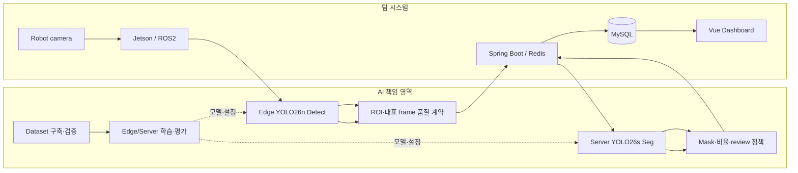

# ROADY — Edge·Server AI 기반 점자블록 손상 분석

순찰 로봇의 영상에서 점자블록 손상 후보를 Jetson에서 찾고, 서버 Segmentation 분석을 시설 관리 화면까지 연결한 AIoT Computer Vision 팀 프로젝트입니다.

## Overview

Edge가 후보와 ROI를 고르고 Server AI가 손상 mask·비율·검토 사유를 반환합니다. Backend는 결과를 저장하고 Vue 관제 화면에 연결합니다. 하나의 모델 성능보다 **Dataset → Edge → Server → Evaluation → Deployment → Integration**의 전체 AI 흐름을 설계한 경험에 초점을 둡니다.

## My Role

**황도경 — 팀 내 AI 단독 담당.** 데이터 구축·가공·검증, Edge/Server 모델 학습·평가, Jetson 모델 준비, AI 입력·응답 계약 및 시스템 연동까지 AI 개발 흐름을 담당했습니다. 1.448TB 전체 자료를 혼자 촬영·라벨링했다는 뜻은 아닙니다. 일부 FastAPI wrapper·후속 점수 정책, ROS 런타임, Backend, Frontend는 다른 팀원이 작성하거나 함께 연동했습니다. [PROVENANCE.md](PROVENANCE.md)에 기여 경계를 정리했습니다.

## Architecture



## AI Pipeline

1. 데이터 출처·split·라벨을 기록하고 Detect/Seg 자료를 검증합니다.
2. Edge YOLO26n이 `tactile_block`과 `damage_candidate`를 탐지합니다.
3. ROI/대표 frame 품질 계약에 따라 원본과 분석 ROI 이벤트를 전달합니다. 최종 ROS 후처리는 Embedded/Server 담당자와 협업했습니다.
4. Server YOLO26s Seg가 점자블록·결손·균열·마모·가림 mask를 추론합니다.
5. 손상 비율과 검토 사유를 Backend 저장·관제 흐름에 전달합니다.

## Edge AI

최종 팀 모델은 **YOLO26n Detect, 768×768, 2 classes**(`tactile_block`, `damage_candidate`)입니다. 운영 weight 이름은 `tactile_damage_candidate_yolo26n_best.pt`이며 SHA-256은 `ROADY_AI/models/edge/tactile_damage_candidate_yolo26n_best.sha256`에 있습니다. weight는 이 후보에 없습니다. `ROADY_AI/tactile_damage_detect/`에 학습·검증·카메라 추론·Jetson export 코드가 있습니다.

`train.py` 기본값: epochs 30, batch 16, AdamW, lr0 0.00015, seed 42, imgsz 768, close_mosaic 5. `damage_candidate`는 최종 파손 확정이 아닌 Server 분석 후보입니다. 별도 손상 분류기는 최종 운영 흐름에서 빠졌고, 장애물 YOLO11n은 별도 기능입니다.

## Server AI와 Damage Analysis

최종 배포 기본은 **YOLO26s Segmentation, 768×768, 5 classes**(`tactile_block`, `missing`, `crack`, `wear`, `obstruction`)의 `yolo26s_seg_multiclass_v4_best.pt`입니다. v3는 rollback 후보입니다. `server_damage_analysis/`의 analyzer·expected region·policy 코드가 mask와 비율 계산을 보여줍니다.

균열·마모는 tactile mask와의 교집합을 사용합니다. 결손은 유효한 예상 블록 영역에서 비율을 추정하고, 불가능하면 `null`로 유지합니다. `missing`은 small/large가 별도 학습 클래스가 아니며 **신뢰 가능한 개별 블록 비율 15%**로 후처리 구분합니다. `obstruction`과 품질 문제는 `review_required`로 연결합니다. `advisory_only=true`인 프로젝트 내부 잠정 정책이며 행정적 확정 기준이 아닙니다. FastAPI wrapper와 후속 점수/대표 유형 수정에는 팀원 기여가 있습니다.

## Dataset Pipeline

공개 자료는 초기 라벨 형식·구조 설계에 활용했고, 최종 시연 모델은 현장 휴대폰·로봇 카메라 자료와 hard negative·replay 검수를 중심으로 구성했습니다. Edge는 YOLO box, Server는 YOLO segmentation polygon 라벨을 사용합니다. 로컬 audit·builder·hard example mining 도구 일부를 `experiments/data_and_edge/`에 보존했습니다. 실제 이미지·라벨은 포함하지 않았고 원본 라이선스와 split 중복은 별도 검증이 필요합니다.

## Evaluation

| 평가 조건 | 지표 | 결과 |
|---|---|---|
| Edge v4 분리된 고정 Test 37장, imgsz 768, 2026-08-07 | `tactile_block` P/R/mAP50/mAP50-95 | 97.0 / 92.8 / 98.6 / 91.2% |
| 같은 Test | `damage_candidate` P/R/mAP50/mAP50-95 | 86.3 / 72.3 / 85.6 / 68.6% |
| Server v4 후보 선택 평가 | 전체 mask mAP50-95 / 선택 점수 | 0.606 / 0.7299 |
| 같은 후보 선택 체계의 v3 | 선택 점수 | 0.6746 |

고정 Test, 후보 선택 평가, 로컬 학습 Validation은 서로 다른 조건입니다. Server v4의 독립 로봇 주행 종단간 평가는 추가 검증이 필요합니다.

## Edge Deployment

Jetson Orin Nano용 ONNX→TensorRT FP16 변환 도구와 SHA 검증 문서를 제공합니다. 팀 benchmark(221프레임, 61.6초, 입력 768, threshold 0.15, 6프레임마다 처리)는 **종단간 3.59 FPS**, callback 평균 46.45ms·p95 55.26ms였습니다. 15 FPS는 목표였고 달성 수치로 주장하지 않습니다. benchmark와 코드 기본 카메라 토픽이 달라 실제 launch 설정 확인이 필요합니다.

## Experiments

`experiments/server_v5/`는 최종 배포와 구분한 **개인 후속 실험** 코드입니다. 로컬 v5 마지막 Validation mask mAP50-95는 0.6711이지만 v4 후보 선택 평가와 동일 Test가 아니므로 우월성을 주장하지 않습니다. v5 weight는 제외했습니다. `experiments/legacy_pre_final/`은 미병합 `feat/roady-ai` 계열 초기 분석 코드이며 최종 운영 코드가 아닙니다.

## System Integration

AI가 Edge 모델·클래스·ROI/프레임 입력 계약, Server 분석 응답과 검토 정책을 제공했습니다. Embedded 담당자는 ROS 이벤트·카메라·로봇 런타임, Backend 담당자는 Redis Worker/DB/API, Frontend 담당자는 Vue 관제 화면을 구현했습니다. 이 후보에는 팀 전체 FE/BE/ROS 코드를 복사하지 않았습니다.

## Tech Stack

Python, Ultralytics YOLO, PyTorch, OpenCV, NumPy, FastAPI, Pydantic, PyYAML. 통합 대상: Jetson Orin Nano/TensorRT, ROS2, Spring Boot, Redis, MySQL, Vue 3.

## Repository Structure

```text
ROADY_AI/                 # 최종 팀 AI 소스·설정·계약·테스트 (가중치 제외)
experiments/data_and_edge/ # 로컬 데이터·Edge 분석 도구
experiments/server_v5/     # 개인 후속 실험 코드
experiments/legacy_pre_final/ # 미병합 초기 분석 실험
PROVENANCE.md              # 코드 출처와 기여 경계
```

## Reproduction

데이터·weight 없이 전체 학습/추론은 재현할 수 없습니다. `ROADY_AI/requirements*.txt`를 참고해 Python 환경을 구성하고, 사용 권한이 있는 자체 데이터의 `dataset.yaml`과 모델 경로를 지정하십시오. syntax/JSON과 weight 불필요 정책 테스트는 확인할 수 있습니다. GPU 학습, Jetson 변환, 실제 로봇·Backend 종단간 실행은 이 후보에서 수행하지 않았습니다.

## Team Project와 Contribution Boundary

ROADY 전체는 팀 프로젝트입니다. **AI 담당자는 황도경 한 명**이었지만 AI 관련 모든 코드의 모든 줄을 혼자 작성한 것은 아닙니다. 팀원이 작성한 FastAPI wrapper·후속 점수·Embedded·Backend·Frontend는 협업 또는 팀 결과물입니다. 특히 Frontend는 황도경 개인 기여가 아닙니다. 이 공개본에는 촬영물을 포함하지 않았으며, 팀 소스의 공개 권한은 게시자가 확인해야 합니다.
