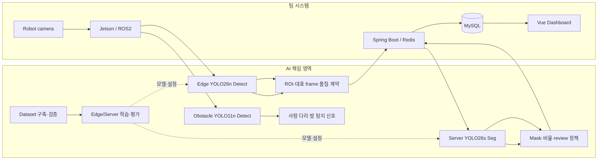

# ROADY — Edge·Server AI 기반 점자블록 손상 분석

순찰 로봇의 영상에서 점자블록 손상 후보를 Jetson에서 찾고, 서버 Segmentation 분석을 시설 관리 화면까지 연결한 AIoT Computer Vision 프로젝트입니다. 저는 ROADY의 전체 AI를 맡아 공개 데이터 검토부터 시연 환경 데이터 수집·라벨링, 모델 개발과 현장 검증까지 진행했습니다.

## Overview

Edge가 후보와 ROI를 고르고 Server AI가 손상 mask·비율·검토 사유를 반환합니다. Backend는 결과를 저장하고 Vue 관제 화면에 연결합니다. 공개 이미지로 학습한 모델을 실제 로봇 카메라에 적용하면서 생긴 미탐·오탐을 데이터와 라벨부터 다시 살펴보고, Edge와 Server 모델을 반복해서 바꿨습니다.

## My Role

**황도경 | 전체 AI 담당**

AI-Hub 데이터 분석과 학습 데이터 구성, 시연 환경 구성·현장 데이터 수집·라벨링 및 검수, 점자블록 손상 분석용 Edge/Server 모델과 사람 다리·발 장애물 탐지 모델, Jetson 배포 준비를 맡았습니다. 로봇 카메라에서 놓친 파손과 흙·낙엽 오탐을 직접 확인하고 라벨과 학습 구성을 고쳐 다시 평가했습니다. ROI·대표 frame의 AI 입력 조건과 Server 결과 형식도 정리해 시스템에 연결했습니다. 아래에는 제가 다룬 데이터와 문제 해결 과정을 코드·기록에 맞춰 적었습니다.

## Architecture



## AI Pipeline

1. 데이터 출처·split·라벨을 기록하고 Detect/Seg 자료를 검증합니다.
2. Edge YOLO26n이 `tactile_block`과 `damage_candidate`를 탐지합니다.
3. ROI/대표 frame 품질 계약에 따라 원본과 분석 ROI 이벤트를 전달합니다. 최종 ROS 후처리는 Embedded/Server 담당자와 협업했습니다.
4. Server YOLO26s Seg가 점자블록·결손·균열·마모·가림 mask를 추론합니다.
5. 손상 비율과 검토 사유를 Backend 저장·관제 흐름에 전달합니다.

## Edge AI

최종 팀 모델은 **YOLO26n Detect, 768×768, 2 classes**(`tactile_block`, `damage_candidate`)입니다. 운영 weight 이름은 `tactile_damage_candidate_yolo26n_best.pt`이며 SHA-256은 `ROADY_AI/models/edge/tactile_damage_candidate_yolo26n_best.sha256`에 있습니다. weight는 이 후보에 없습니다. `ROADY_AI/tactile_damage_detect/`에 학습·검증·카메라 추론·Jetson export 코드가 있습니다.

`train.py` 기본값: epochs 30, batch 16, AdamW, lr0 0.00015, seed 42, imgsz 768, close_mosaic 5. `damage_candidate`는 최종 파손 확정이 아닌 Server 분석 후보입니다.

## 장애물 탐지 — YOLO11n

점자블록 손상 분석과 별도로, 로봇의 장애물용 USB 카메라에서 사람의 발·하체를 찾는 **YOLO11n Detect** 모델을 개발했습니다. 입력 640, `foot`·`lower_leg` 2클래스이며, 어느 쪽이든 탐지되면 로봇 연동 신호 `human_lower_limb_detected=true`를 만듭니다. COCO Body Part의 해당 클래스 변환본에 의자·책상 다리, 기둥, 그림자 같은 hard negative를 보강하고, 실제 카메라 위치·시점에서 수집·검증하도록 구성했습니다. [학습·데이터 검증·카메라 시험·Jetson TensorRT FP16 export 코드](ROADY_AI/obstacle_lower_limb/)를 포함하며 모델 가중치와 TensorRT engine은 포함하지 않았습니다.

## Server AI와 Damage Analysis

최종 배포 기본은 **YOLO26s Segmentation, 768×768, 5 classes**(`tactile_block`, `missing`, `crack`, `wear`, `obstruction`)의 `yolo26s_seg_multiclass_v4_best.pt`입니다. v3는 rollback 후보입니다. `server_damage_analysis/`의 analyzer·expected region·policy 코드가 mask와 비율 계산을 보여줍니다.

균열·마모는 tactile mask와의 교집합을 사용합니다. 결손은 유효한 예상 블록 영역에서 비율을 추정하고, 불가능하면 `null`로 유지합니다. `missing`은 small/large가 별도 학습 클래스가 아니며 **신뢰 가능한 개별 블록 비율 15%**로 후처리 구분합니다. `obstruction`과 품질 문제는 `review_required`로 연결합니다. `advisory_only=true`인 프로젝트 내부 잠정 정책이며 행정적 확정 기준이 아닙니다.

## Dataset Pipeline

처음에는 AI-Hub의 [보행 안전을 위한 도로 시설물 데이터](https://www.aihub.or.kr/aihubdata/data/view.do?dataSetSn=513)와 [인도보행 영상](https://aihub.or.kr/aihubdata/data/view.do?dataSetSn=189)을 사용했습니다. 초기 통합 단계에서 각각 26,595장과 8,137장의 점자블록 관련 이미지를 선별해 **원본 기준 34,732장**으로 구성했습니다. Polygon 라벨을 Edge 학습용 YOLO box로 변환하고, 클래스 매핑·이미지/라벨 대응·좌표 범위·중복을 검증했습니다. 이 수치는 초기 공개 데이터 통합본이며 최종 시연 학습 세트의 크기가 아닙니다.

공개 데이터만으로는 시연 장소의 파손 모양과 로봇 카메라 시점을 충분히 다루기 어려웠습니다. 저는 **시연 환경을 직접 구성하고 휴대폰·로봇 카메라로 현장 데이터를 수집**해 결손·균열·마모·거치물 사례를 보강했습니다. Edge용 box와 Server용 polygon을 라벨링·수정하고, 미탐 위치를 수동 추가하고 흙·낙엽 등 오탐 라벨을 제거했습니다. 촬영 원본과 연속 frame이 Train/Validation/Test에 섞이지 않도록 촬영 그룹으로 분리하고, 고정 Val/Test에 겹치는 원본은 재학습에서 제외했습니다. [시연환경 데이터셋 문서](ROADY_AI/dataset_docs/demo_environment/README.md)에 클래스·라벨 기준·split 원칙을 기록했습니다.

실제 이미지·라벨과 AI-Hub 원본은 저장소에 넣지 않았습니다. 대신 [`build_dataset.py`](ROADY_AI/tactile_damage_detect/build_dataset.py), 검증 코드와 [`experiments/data_and_edge/`](experiments/data_and_edge/)에 데이터 변환·검수 도구를 남겼습니다.

## Troubleshooting

| 겪은 문제 | 확인하고 바꾼 것 | 결과 |
|---|---|---|
| 작은 손상 미탐 | 초기 실패 사례를 손상 면적별로 나누어 보고, 점자블록 중심 ROI crop·겹침 tile·768 입력과 threshold를 검토했습니다. | 작은 손상이 전체 이미지에서 차지하는 비율이 작다는 병목을 찾아 ROI 중심 학습으로 방향을 바꿨습니다. |
| 흙·낙엽·그림자 오탐과 현장 미탐 | 현장 예측 233건의 검수 기록을 바탕으로 잘못된 box를 제거하고, 누락된 파손 box 50여 개를 수동 보강했습니다. 흙·낙엽은 파손 양성이 아닌 hard negative로 관리했습니다. | 교정한 라벨과 hard negative를 재학습 데이터에 반영했습니다. |
| 큰 결손 누락 | 현장 영상의 hard frame 42개와 수동 미탐 box 99개로 Edge v4 replay를 구성했습니다. | 재학습에 넣은 사례는 confidence 0.15에서 99개 중 88개 box를 다시 찾았습니다. 이는 독립 Test 결과가 아닙니다. |
| 가림 물체와 면적 계산 불가 | 점자블록 위 거치물은 Server의 `obstruction`으로 분리하고, 신뢰할 수 없는 mask·예상 영역에서는 손상 비율을 0으로 확정하지 않고 검토 대상으로 돌렸습니다. | 판단하기 어려운 상황을 `review_required`로 명시해 잘못된 자동 확정을 줄이도록 설계했습니다. |
| Jetson 처리량 | callback 시간과 종단간 FPS를 따로 측정하고 6프레임마다 처리하는 구성을 확인했습니다. | 실제 종단간 **3.59 FPS**를 확인했고, 15 FPS 목표와의 차이를 다음 최적화 과제로 남겼습니다. |

## Evaluation

| 평가 조건 | 지표 | 결과 |
|---|---|---|
| Edge v4 분리된 고정 Test 37장, imgsz 768, 2026-08-07 | `tactile_block` P/R/mAP50/mAP50-95 | 97.0 / 92.8 / 98.6 / 91.2% |
| 같은 Test | `damage_candidate` P/R/mAP50/mAP50-95 | 86.3 / 72.3 / 85.6 / 68.6% |
| Server v4 후보 선택 평가 | 전체 mask mAP50-95 / 선택 점수 | 0.606 / 0.7299 |
| 같은 후보 선택 체계의 v3 | 선택 점수 | 0.6746 |

고정 Test, 후보 선택 평가, 로컬 학습 Validation은 서로 다른 조건입니다. Server v4의 독립 로봇 주행 종단간 평가는 추가 검증이 필요합니다.

## Edge Deployment

Jetson Orin Nano용 ONNX→TensorRT FP16 변환 도구와 SHA 검증 문서를 제공합니다. 팀 benchmark(221프레임, 61.6초, 입력 768, threshold 0.15, 6프레임마다 처리)는 **종단간 3.59 FPS**, callback 평균 46.45ms·p95 55.26ms였습니다. 15 FPS는 목표였고 달성 수치로 주장하지 않습니다. benchmark와 코드 기본 카메라 토픽이 달라 실제 launch 설정 확인이 필요합니다.

## Experiments

`experiments/server_v5/`는 최종 배포와 구분한 **개인 후속 실험** 코드입니다. 로컬 v5 마지막 Validation mask mAP50-95는 0.6711이지만 v4 후보 선택 평가와 동일 Test가 아니므로 우월성을 주장하지 않습니다. v5 weight는 제외했습니다. `experiments/legacy_pre_final/`은 미병합 `feat/roady-ai` 계열 초기 분석 코드이며 최종 운영 코드가 아닙니다.

## System Integration

AI가 Edge 모델·클래스·ROI/프레임 입력 계약, Server 분석 응답과 검토 정책을 제공했습니다. Embedded 담당자는 ROS 이벤트·카메라·로봇 런타임, Backend 담당자는 Redis Worker/DB/API, Frontend 담당자는 Vue 관제 화면을 구현했습니다. 이 후보에는 팀 전체 FE/BE/ROS 코드를 복사하지 않았습니다.

## Tech Stack

Python, Ultralytics YOLO, PyTorch, OpenCV, NumPy, FastAPI, Pydantic, PyYAML. 통합 대상: Jetson Orin Nano/TensorRT, ROS2, Spring Boot, Redis, MySQL, Vue 3.

## Repository Structure

```text
ROADY_AI/                 # 최종 팀 AI 소스·설정·계약·테스트 (가중치 제외)
ROADY_AI/obstacle_lower_limb/ # 사람 발·하체 장애물 탐지 YOLO11n
experiments/data_and_edge/ # 로컬 데이터·Edge 분석 도구
experiments/server_v5/     # 개인 후속 실험 코드
experiments/legacy_pre_final/ # 미병합 초기 분석 실험
PROVENANCE.md              # 코드 출처와 기여 경계
```

## Reproduction

데이터·weight 없이 전체 학습/추론은 재현할 수 없습니다. `ROADY_AI/requirements*.txt`를 참고해 Python 환경을 구성하고, 사용 권한이 있는 자체 데이터의 `dataset.yaml`과 모델 경로를 지정하십시오. syntax/JSON과 weight 불필요 정책 테스트는 확인할 수 있습니다. GPU 학습, Jetson 변환, 실제 로봇·Backend 종단간 실행은 이 후보에서 수행하지 않았습니다.

## 팀과의 연결

ROADY는 팀 프로젝트입니다. 저는 **전체 AI를 담당**하고, Embedded·Backend·Frontend 담당자와 입력·결과 형식을 맞춰 서비스를 연결했습니다. 각 코드의 출처와 협업 영역은 [PROVENANCE.md](PROVENANCE.md)에 정리했습니다. 이 공개본에는 원본 촬영물과 모델 가중치를 포함하지 않았습니다.
